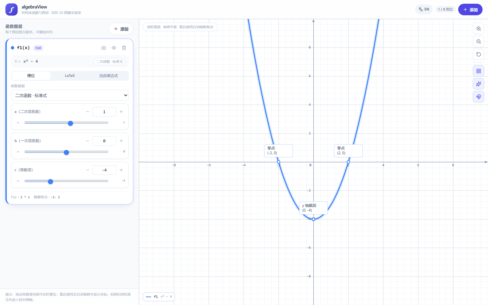
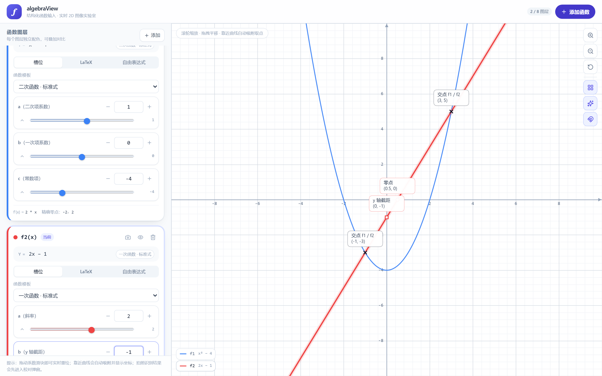
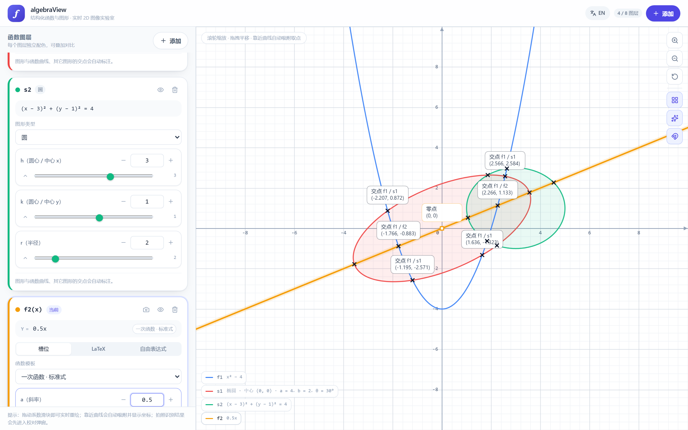
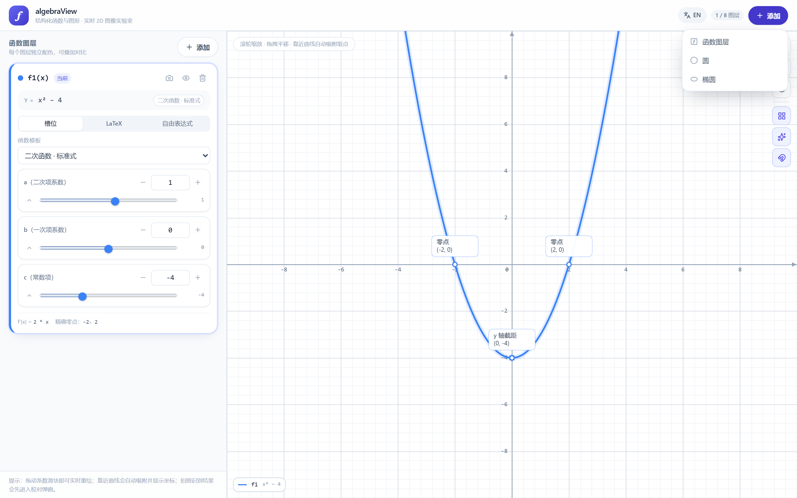
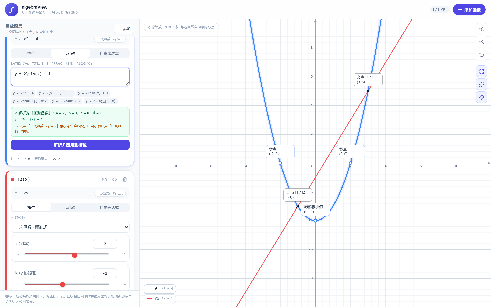
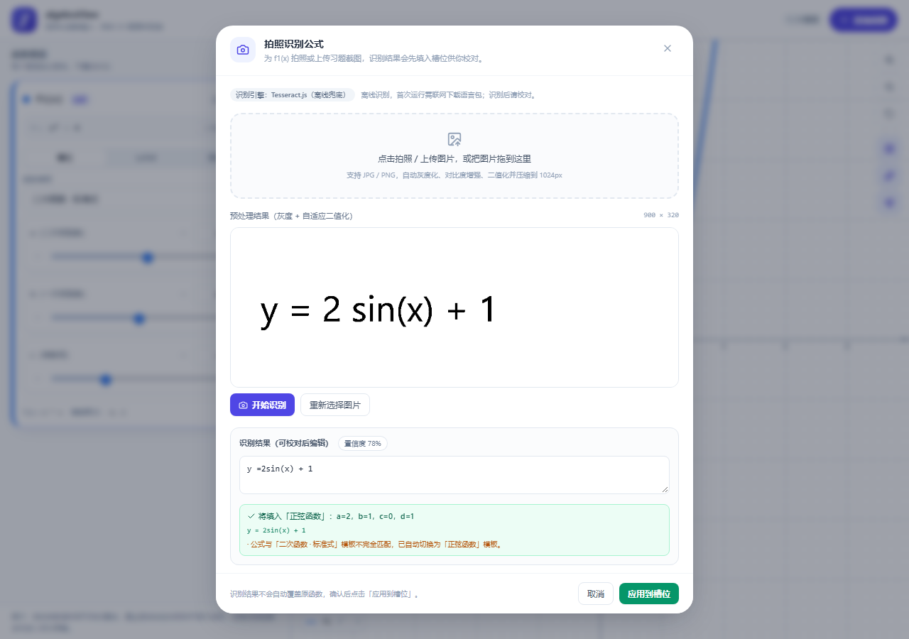
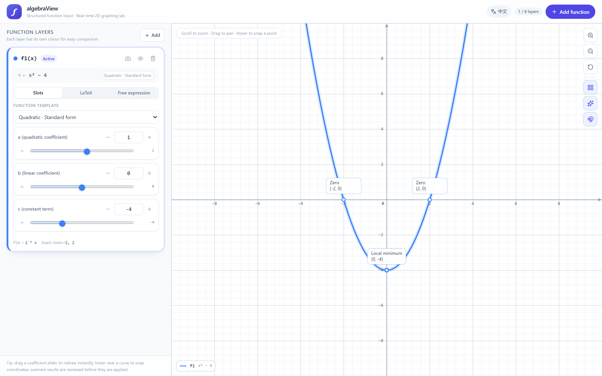
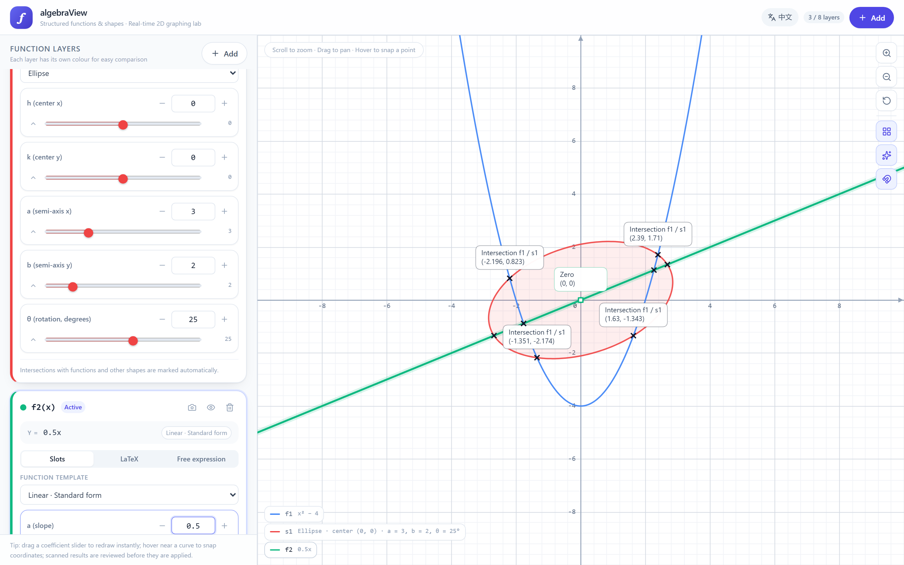
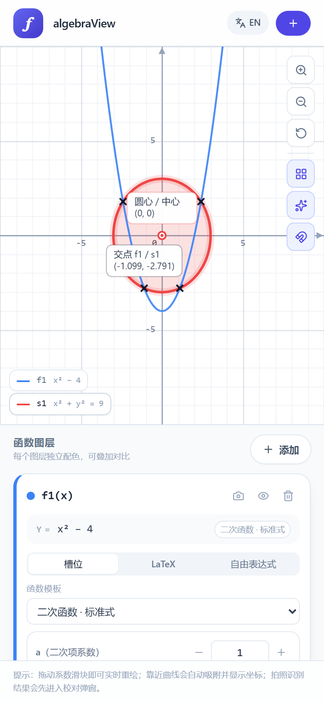

# algebraView

> 结构化函数输入 · 实时 2D 图像实验室
> 纯客户端单页应用（SPA / PWA），为代数学习提供「填空式输入 + 即时图像 + 代数特征点 + 拍照识别」的完整闭环。

实现依据：`algebraView` Software Design Specification v1.0.0（结构化函数输入、多图层、2D 坐标系、OCR、PWA 与 GitHub Pages 流水线）。

---

## 1. 功能一览

| 模块 | 实现 |
| --- | --- |
| **结构化填空输入** | 多项式（可动态增减项）、一次/二次标准式、顶点式、三角、指数、对数共 8 套模板；每个系数独立数字输入 + 步进器 + 可折叠滑块（默认 `-10 ~ 10`，步长 `0.5`） |
| **LaTeX 输入** | 独立页签实时解析，支持 `\frac`、`\sqrt`、`\pi`、`\sin`、`\log_{b}`、花括号指数等；非法输入给出错误定位与具体修改建议，可一键写回槽位 |
| **自由表达式兜底** | `sin(x)/x`、`1/x`、`abs(x)` 等任意 mathjs 表达式，实时校验并绘制 |
| **拍照识别（OCR）** | 摄像头/文件上传 → Canvas 灰度化 + 对比度拉伸 + Otsu 二值化（≤1024px）→ `MathOCRProvider` 接口；默认 Tesseract.js 离线兜底，配置 Mathpix 环境变量后切换云端高精度；识别结果进入校对弹窗再回填槽位 |
| **多图层管理** | 最多 8 个图层，高对比度唯一配色，显隐/激活/删除，`+` 菜单新增；函数与图形共享同一画布，图例可点击聚焦 |
| **2D 图形（圆 / 旋转椭圆）** | 圆（圆心 + 半径）、椭圆（中心 + 双半轴 + 旋转角 θ）；自动标注中心、顶点、焦点；支持与函数曲线、其它图形求交（函数×图形、图形×图形） |
| **2D 笛卡尔引擎** | 1/2/5 自适应网格刻度、滚轮/双指缩放（锚点不漂移）、拖拽平移、一键重置；`requestAnimationFrame` + 脏标记重绘 |
| **智能吸附与特征点** | 指针靠近曲线自动吸附并显示 `(x, y)` 浮窗；自动求解并标注激活函数的零点、y 轴截距、局部极值，以及任意两条曲线的交点 |
| **间断点保护** | 采样时对 NaN/∞ 与斜率突变处主动断开 `lineTo`，`1/x`、`tan(x)`、`1/x²` 不会出现错误竖线 |
| **符号分析** | mathjs 提供 `f′(x)`；nerdamer 懒加载提供精确零点，失败自动回退数值引擎 |
| **中英双语** | 顶栏一键切换 `EN / 中文`；首次访问按浏览器语言自动选择并通过 `localStorage` 记忆。界面、模板/槽位名称、LaTeX 与 OCR 错误建议、特征点标签全部同步本地化 |
| **PWA** | `public/manifest.json`（`display: standalone`）、SVG 图标、主题色，可「添加到主屏幕」 |

---

## 界面预览

| 桌面端总览 | 多图层与交点自动标注 |
| --- | --- |
|  |  |

| 2D 图形与混合交点 | 添加图层菜单 |
| --- | --- |
|  |  |

| LaTeX 实时校验 | 拍照识别 → 校对 → 回填 |
| --- | --- |
|  |  |

**English UI**（same graph, fully localized interface）：



**2D shapes in English**：



<p align="center">
  
</p>

---

## 2. 技术栈

| 层次 | 选型 |
| --- | --- |
| Runtime & Build | Node.js `>= 20`、Vite `^5.4` |
| Core Framework | React `^18.3`、TypeScript `^5.9`（`strict` + `noImplicitAny`，禁止 `any`） |
| State | Zustand `^4.5`（图层数组、视口、偏好） |
| Styling & Icons | Tailwind CSS `^3.4`、Lucide React |
| Math Engine | `mathjs`（编译 / 采样 / 符号求导）、`nerdamer`（符号求根，懒加载） |
| Graphics | 原生 HTML5 Canvas 2D |
| OCR | `tesseract.js` 离线兜底、Mathpix REST API（可选） |
| Testing | Vitest（单元）、Playwright（端到端画布交互冒烟） |

---

## 3. 本地开发

```bash
# 1. 安装依赖（Node 20+）
npm install

# 2. 启动开发服务器（默认 http://localhost:5173/algebraView/）
npm run dev

# 3. 单元测试（数学引擎 / 解析器 / 状态 / 渲染几何）
npm run test

# 4. 端到端冒烟测试（需先安装浏览器：npx playwright install chromium）
npm run build
npm run test:e2e

# 5. 生产构建 + 本地预览
npm run build && npm run preview
```

> 所有命令在 Windows / macOS / Linux 一致；GitHub Actions 使用 Node 20。

### OCR 环境变量

复制 `.env.example` 为 `.env`（或直接在 CI / 本地环境注入）：

```dotenv
# Mathpix 云端高精度识别（可选）
VITE_MATHPIX_APP_ID=
VITE_MATHPIX_APP_KEY=

# 开发演示：true 时使用内置示例公式，不发起网络请求
VITE_OCR_DEMO=false
```

- 未配置 Mathpix 时自动使用 **Tesseract.js** 离线引擎；首次识别需要联网下载语言包，识别结果为纯文本并启发式转换为 LaTeX，**请务必在校对弹窗确认**。
- 配置 Mathpix 后使用 `https://api.mathpix.com/v3/text`，质量与公式结构识别显著更好。
- 也可设置 `VITE_OCR_DEMO=true` 在没有摄像头/网络的环境下体验完整「识别 → 校对 → 回填」流程。

---

## 4. 质量门禁

提交前必须依次通过（任一失败即阻断提交）：

```bash
npm run typecheck   # tsc --noEmit，零类型错误
npm run lint        # ESLint，零 Warning / Error（--max-warnings 0）
npm run test        # Vitest，数学引擎与解析器用例全部通过
npm run build       # vite build，产出 dist/
```

也可一次运行：`npm run verify`。

当前测试基线：**12 个测试文件 / 125 个用例全部通过**，覆盖：

- 模板表达式构建与求值（8 套模板）
- mathjs 编译、缓存、错误信息、采样与定义域缺口
- LaTeX 归一化、模板匹配、失败建议（含 UC-03 识别映射）
- 零点（含重根/渐近线防误报）、极值、y 截距、交点求解
- 曲线间断点分段（`1/x`、`1/x²`、`tan`、`sqrt`）
- 视口缩放锚点不变性、平移、1/2/5 刻度
- Zustand 图层 CRUD、模板切换、槽位、原始表达式、视口
- 符号求导与 nerdamer 精确求根（含去重 / 排序 / 不可解降级）
- 图像预处理：灰度化、低对比度保护、自适应（积分图）二值化、反色、Otsu 兜底
- OCR 引擎选择（Mathpix / Tesseract / Demo）与「识别文本 → LaTeX → 槽位」映射
- 中英双语字典完整性、插值、模板/槽位名称、解析器与数学引擎错误本地化
- 圆/旋转椭圆的参数采样、隐式值、中心/顶点/焦点、公式格式化
- 函数×图形、图形×图形数值求交；混合图层特征点与吸附

端到端冒烟（Playwright，桌面 Chromium + 移动 Chromium）**28 个用例全部通过**，覆盖初始渲染、UC-01 滑块联动、UC-02 多图层、圆/旋转椭圆参数与混合交点、LaTeX 应用与错误建议、多项式增删项、视口/网格/吸附开关、8 图层上限、OCR 弹窗、中英切换与删除图层、符号求导/精确零点。

---

## 5. 部署到 GitHub Pages

仓库：<https://github.com/xieminglang822/algebraView>

1. 首次推送 `main` 后，在仓库 **Settings → Pages → Build and deployment** 中将 Source 设为 **GitHub Actions**。
2. `.github/workflows/deploy.yml` 会在每次 `push` 到 `main` 或手动 `workflow_dispatch` 时执行：
   `checkout → setup-node 20 (npm cache) → npm ci → typecheck → lint → test → build → upload-pages-artifact → deploy-pages`。
3. 发布地址：`https://xieminglang822.github.io/algebraView/`。

`vite.config.ts` 中 `base: '/algebraView/'` 必须与仓库名称严格一致。

---

## 6. 目录结构

```text
algebraView/
├── .github/workflows/deploy.yml   # GitHub Pages CI/CD
├── docs/screenshots/              # README 界面预览图
├── e2e/app.spec.ts                # Playwright 冒烟用例
├── public/                        # PWA manifest + SVG 图标
├── scripts/static-server.mjs      # 无依赖静态预览服务器（E2E / 本地 dist 预览）
├── src/
│   ├── core/
│   │   ├── mathParser.ts          # mathjs 编译、求值、采样、错误诊断
│   │   ├── latexParser.ts         # LaTeX 归一化 + AST 结构匹配 + 修改建议
│   │   ├── featureFinder.ts       # 零点 / 极值 / 截距 / 函数与图形交点数值求解
│   │   ├── shapes.ts              # 圆/旋转椭圆几何、参数、特征点、公式
│   │   ├── templates.ts           # 模板、槽位、图层工厂、表达式构建
│   │   ├── symbolic.ts            # mathjs 导数 + nerdamer 精确求根
│   │   ├── ocrAdapter.ts          # MathOCRProvider（Tesseract / Mathpix / Demo）与回填
│   │   ├── imageProcessing.ts     # 灰度化、对比度保护、自适应二值化、Otsu 兜底
│   │   ├── numberFormat.ts        # 数值格式化 / 夹取
│   │   └── types.ts               # 领域类型
│   ├── canvas/
│   │   ├── CoordinateSystem.ts    # 世界↔屏幕映射、网格 / 轴 / 标签渲染
│   │   ├── CurveRenderer.ts       # 自适应采样、间断点分段、抗锯齿绘制
│   │   ├── ShapeRenderer.ts       # 圆/椭圆半透明填充与轮廓绘制
│   │   ├── snapping.ts            # 曲线、图形轮廓与特征点吸附
│   │   └── viewport.ts            # 视口缩放 / 平移 / 1-2-5 刻度
│   ├── store/useGraphStore.ts     # Zustand 全局状态树
│   ├── i18n/                      # 中英字典、locale 检测/持久化、useTranslation
│   ├── hooks/                     # 编译层、特征点防抖、符号分析
│   ├── components/
│   │   ├── FunctionCard.tsx       # 函数卡片（槽位 / LaTeX / 自由表达式）
│   │   ├── ShapeCard.tsx          # 圆/椭圆参数卡片（含旋转角）
│   │   ├── AddLayerMenu.tsx       # 添加函数 / 圆 / 椭圆菜单
│   │   ├── BlankInputSlot.tsx     # 系数输入 + 步进器 + 折叠滑块
│   │   ├── GraphCanvas.tsx        # Canvas、手势、吸附浮窗、图例
│   │   └── OcrModal.tsx           # 拍照 / 上传 / 识别 / 校对
│   ├── App.tsx                    # 响应式布局（桌面左右 / 移动上下）
│   └── main.tsx
├── vite.config.ts
├── vitest.config.ts
├── playwright.config.ts
└── package.json
```

---

## 7. 验收场景对照

| 场景 | 复现步骤 | 自动化覆盖 |
| --- | --- | --- |
| **UC-01 二次函数形态探索** | 选二次标准式 → `a=1,b=0,c=-4` → 拖 `a` 到 `-1` | `e2e/app.spec.ts` · UC-01；`latexParser.test.ts` 映射用例 |
| **UC-02 多函数对比与交点** | 新增第二图层 → 一次函数 → `y=2x-1` → 靠近交点吸附 | `featureFinder.test.ts` 交点用例；`e2e` 多图层用例 |
| **UC-03 纸质习题拍照识别** | 卡片相机图标 → 拍照/上传 → 校对 `2sin(x)+1` → 应用 | `latexParser.test.ts` UC-03 四槽位映射；`e2e` 弹窗开合 |
| **图形与混合交点** | “+”菜单添加圆/椭圆 → 调半径与旋转角 → 再添加函数直线 | `shapes.test.ts` 几何用例；`featureFinder.test.ts` 函数×图形/图形×图形；`e2e` 混合交点用例 |

> 画布上的吸附浮窗与特征点标记由 Canvas 直接绘制，非 DOM 节点；E2E 中断言画布存在与交互按钮状态，视觉结果通过人工/截图检查。

---

## 8. Git 工作流约定

- `main`：受保护生产分支，仅通过已通过 4 项门禁的合并进入，推送即触发发布。
- `feat/<feature-name>`、`fix/<issue-desc>`：功能 / 修复分支。
- 提交信息遵循 Conventional Commits：`feat(ui): …`、`fix(math): …`、`ci(deploy): …`。
- 建议合并前本地执行 `npm run verify`。

---

## 9. 已知边界

- **Tesseract.js 数学识别精度有限**：其输出为普通文本，经启发式转换后才进入 LaTeX 解析；生产环境建议配置 Mathpix。离线引擎首次运行需要联网下载 `eng.traineddata`。预处理已改为自适应二值化（含低对比度保护与反色），实测可正确读取印刷体 `y = 2sin(x) + 1` 并回填四个正弦槽位。
- **nerdamer 按需加载**：主包不包含符号引擎；若网络/打包环境缺失该 chunk，界面自动回退为 mathjs 导数 + 数值求根，不影响绘图。符号引擎返回的根会排序、去重，并只在当前视口 x 范围内展示。
- 数值求根在极端高频振荡函数上可能遗漏部分根；可通过缩放视口重新求解（求解会随视口防抖重算）。
- **图形求交为数值解**：函数×图形在图形参数 `t ∈ [0, 2π]` 上求根，图形×图形在参数曲线上求另一图形的隐式方程；切点、渐近线附近会做残差过滤，但极端病态曲线仍建议缩放后复核。
- 图形首版只支持圆与旋转椭圆；不包含双曲线、抛物线、图形填充样式编辑或 3D 立体几何。3D 仍是后续独立阶段。
- 构建产物主 chunk 约 946 kB（gzip 约 283 kB），已对 nerdamer / Tesseract 做动态拆分；后续可按需进一步拆分 mathjs。
